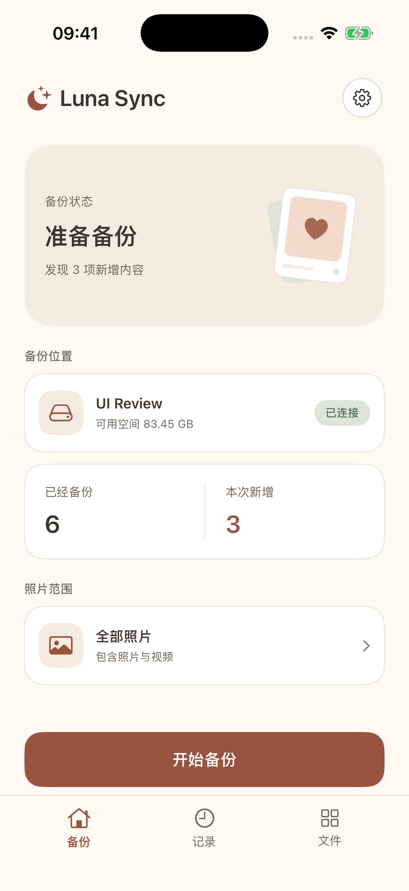
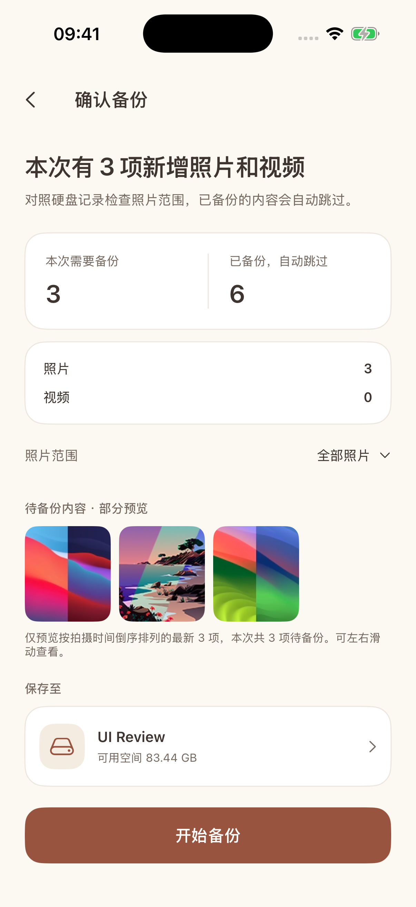

  
  <h1>Luna Sync · 相存</h1>
  
Back up original iPhone photos and videos directly to your own drive.

  

    
    
    
    
  

  

    <a href="#getting-started">Getting started</a> ·
    <a href="docs/DEVELOPMENT.md">Build & install</a>
  

English · <a href="README.md">简体中文</a>

Luna Sync is a local iPhone photo backup app. Connect an external drive, choose a folder and a photo range, and copy original files directly to the drive. On your next backup, completed items are skipped while new and unfinished items are processed. No account or companion server is required.

## Original files, incremental backups

  
  

Simulator screenshots with sample photos and storage figures.

- **Keep originals**: photos, videos, RAW/JPEG and paired Live Photo resources retain their original formats and filenames. Name conflicts receive a numbered suffix.
- **Choose what to back up**: the whole library, a date range, individual items, swipe selection or an interval between two endpoints.
- **Continue after interruptions**: completed files are kept when you reconnect the original folder. An unfinished file restarts from the beginning.
- **Verify before completion**: each resource is read back and checked with SHA-256 before its completion record is committed. A Live Photo is complete only when all its resources succeed.
- **Keep backups independent**: the app does not delete photos from your phone or mirror library deletions to the drive.

## Photo & video browsing

A separate file browser supports folders, grid and list views, search, sorting, image and video filters, original-file previews and swiping between files.

Previews load on demand with a bounded in-memory cache; the app does not write thumbnail caches to the external drive. Backup records and temporary progress stay in the hidden `.luna-sync` folder. Your photos remain ordinary files you can open directly.

## Getting started

Requires **iOS 18+** and an external drive accessible in Apple's Files app. There is currently no public App Store or TestFlight installation. Build the app on a Mac with Xcode; see [Build & install](docs/DEVELOPMENT.md).

1. Connect a drive, grant photo access and choose a backup folder.
2. Select a photo range, scan and review the pending items.
3. Start the backup and review the result. Choose the same folder next time to continue.

Only local originals are read by default. Enable original downloads in Settings to include items stored only in iCloud. Keep the app in the foreground where possible; continued background processing depends on iOS. Backups contain original resources, excluding crops, color adjustments and edit history from the Photos app.

## Development & documentation

Built with SwiftUI and PhotoKit, with photo selection based on [ZLPhotoBrowser](https://github.com/longitachi/ZLPhotoBrowser). The backup engine is a separate Swift module with standalone core tests.

The detailed guides below are currently in Chinese.

- [Development, build & install](docs/DEVELOPMENT.md)

## Acknowledgments

Thanks to [ZLPhotoBrowser](https://github.com/longitachi/ZLPhotoBrowser) and its contributors. The vendored modifications retain its Apache 2.0 license; see [Third-party notices](THIRD_PARTY_NOTICES.md).

## License

Luna Sync is released under the [MIT License](LICENSE). Third-party components retain their respective licenses; see [Third-party notices](THIRD_PARTY_NOTICES.md).
