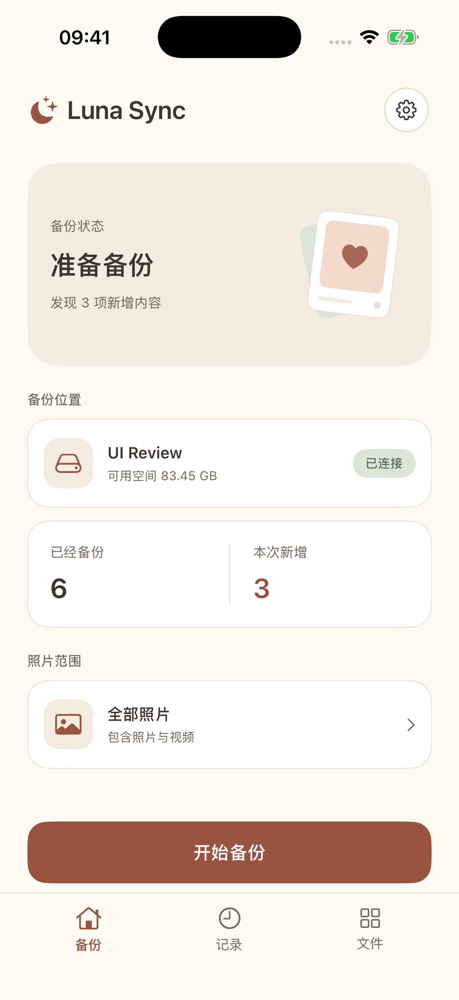
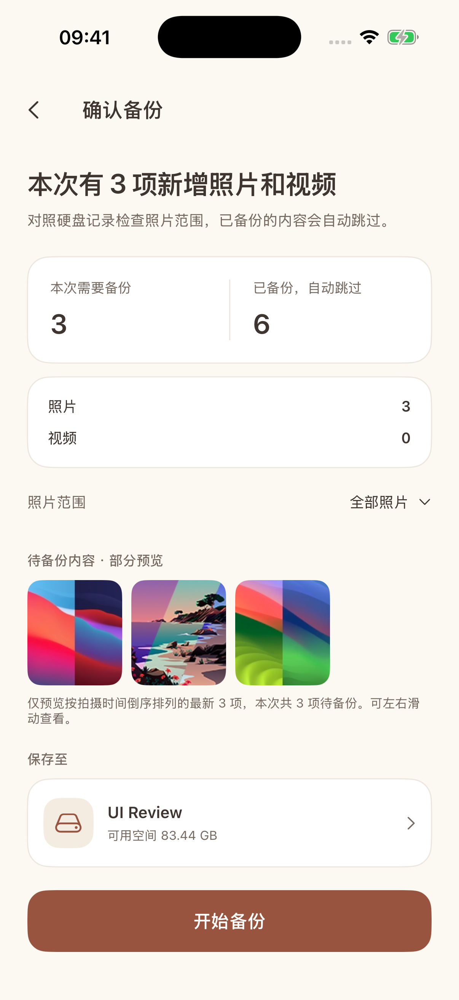

  
  <h1>Luna Sync · 相存</h1>
  
把 iPhone 里的照片和视频，直接备份到自己的硬盘。

  

    
    
    
    
  

  

    <a href="#开始使用">开始使用</a> ·
    <a href="docs/DEVELOPMENT.md">构建与安装</a> ·
    <a href="docs/DATA_AND_RECOVERY.md">数据与恢复</a> ·
    <a href="https://github.com/rainj2013/luna-sync/issues">反馈问题</a>
  

<a href="README.en.md">English</a> · 简体中文

Luna Sync 是一个纯本地的 iPhone 照片备份工具。接上外置存储，选择目录和照片范围，就能把原始文件直接备份过去；下次连接时跳过已完成的内容，继续处理新增和未完成的照片。无需账号，也不需要配套服务端。

## 原片备份，增量继续

  
  

模拟器截图，照片与容量数据仅用于展示。

- **保留原片**：支持照片、视频、RAW/JPEG 和 Live Photo 配套资源，保留原始格式与文件名，同名时自动加序号。
- **按范围备份**：全部照片、日期范围，或逐张、滑动、首尾区间选择。
- **中断后继续**：保留已完成内容，重新连接原目录后继续；未完成的单个文件从头重传。
- **写完再确认**：每个资源写入后读回，通过 SHA-256 校验才提交完成记录；Live Photo 全部资源完成才算成功。
- **备份独立保留**：不会删除手机照片，也不会跟随相册删除硬盘上的文件。

## 图片与视频浏览

独立的文件浏览器支持逐层浏览目录、网格与列表、搜索、排序、图片与视频筛选，以及原文件预览和左右切换。

浏览时按需加载，在内存中保留有限的预览，不向外置存储写入缩略图缓存。备份记录和临时进度集中保存在同步目录下的 `.luna-sync` 隐藏目录，照片仍是可以直接打开的普通文件。

## 开始使用

需要 **iOS 18+**，以及能被系统“文件”App 识别和访问的外置存储。当前没有 App Store 或 TestFlight 公开安装入口，可在 Mac 上使用 Xcode 自行构建，见[构建与安装](docs/DEVELOPMENT.md)。

1. 连接外置存储，允许照片权限，选择备份目录。
2. 选择照片范围，扫描并确认本次需要备份的内容。
3. 开始备份，完成后查看结果；下次选择同一个目录继续。

默认只读取本地原片；需要备份仅在 iCloud 上的内容时，可在设置中允许下载原片。建议保持 App 在前台，后台能否继续由系统决定。备份保留原始资源，不包含照片 App 的裁剪、调色结果和编辑历史。

## 开发与文档

界面使用 SwiftUI，照片读取使用 PhotoKit，照片选择基于 [ZLPhotoBrowser](https://github.com/longitachi/ZLPhotoBrowser)。备份引擎独立为 Swift 模块，可单独运行核心测试。

- [开发、构建与安装](docs/DEVELOPMENT.md)
- [数据布局、校验与恢复](docs/DATA_AND_RECOVERY.md)

## 致谢

感谢 [ZLPhotoBrowser](https://github.com/longitachi/ZLPhotoBrowser) 及其作者和贡献者。项目使用的本地修改版保留了原 Apache 2.0 许可证，详见[第三方软件说明](THIRD_PARTY_NOTICES.md)。

## 许可证

Luna Sync 基于 [MIT License](LICENSE) 发布。第三方组件保留各自的许可证，详见[第三方软件说明](THIRD_PARTY_NOTICES.md)。
